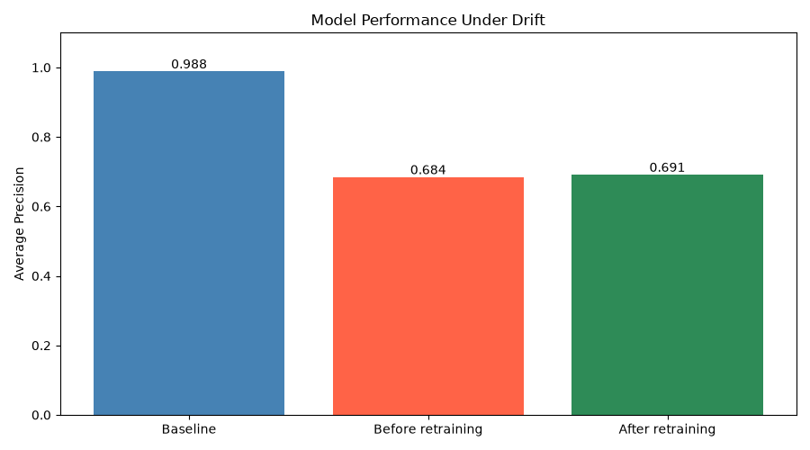
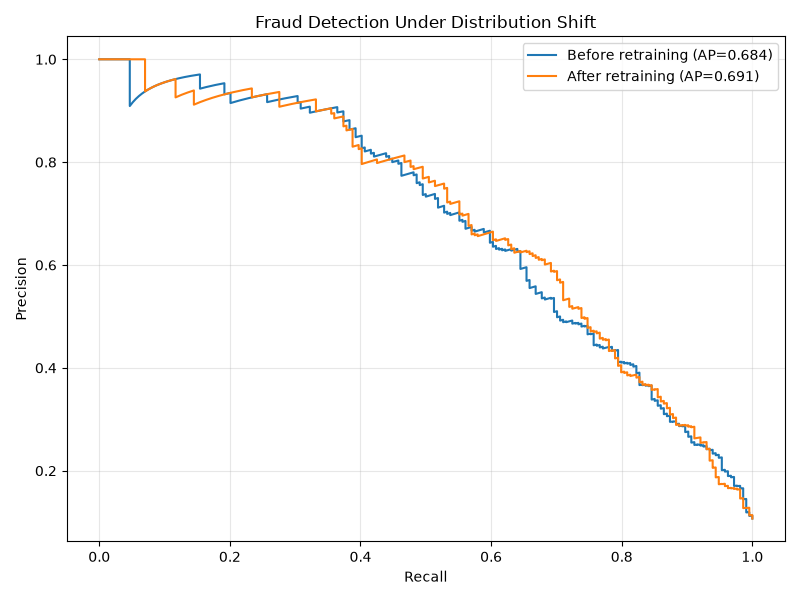
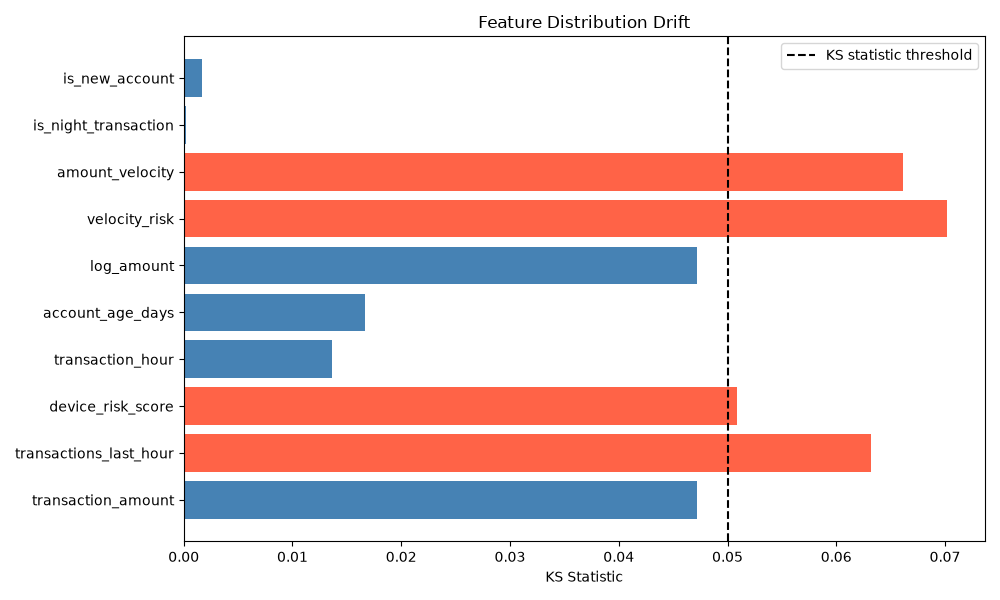

# Adaptive Fraud Detection

An experimental machine learning pipeline for studying fraud detection, distribution drift and model retraining.

## Project Overview

This project investigates how changing fraud patterns affect machine learning performance and whether retraining with newly labeled transactions improves detection.

## Key Features

- 15,000 synthetic financial transactions
- Behavioral feature engineering
- XGBoost classification
- Imbalanced data handling
- Statistical drift detection using the KS test
- Adaptive model retraining
- Precision-recall evaluation
- Automated unit testing

## Architecture

Synthetic Transactions → Feature Engineering → XGBoost Training → Drift Detection → Retraining → Evaluation

## Experimental Results

| Scenario | Average Precision |
|---|---:|
| Baseline test data | 98.85% |
| Shifted data before retraining | 68.41% |
| Shifted data after retraining | 69.12% |

## Adapted Model Performance

| Metric | Result |
|---|---:|
| Accuracy | 91% |
| Fraud Precision | 57% |
| Fraud Recall | 70% |
| Fraud F1-score | 63% |

## Key Findings

Changing fraud patterns significantly reduced model performance.

Retraining with newly labeled transactions improved average precision by approximately 0.70 percentage points, but did not restore baseline performance.

## Visualizations

### Model Performance Comparison

### Precision-Recall Curve

### Feature Distribution Drift

## Installation

    python -m pip install -r requirements.txt

## Running the Pipeline

    python -m src.generate_data
    python -m src.features
    python -m src.train
    python -m src.drift
    python -m src.evaluate

## Testing

    python -m pytest tests/ -v

## Technologies

Python, NumPy, Pandas, XGBoost, Scikit-learn, SciPy, Matplotlib, Joblib and Pytest.

## Limitations

- Uses synthetic data rather than real financial transactions.
- Retraining requires newly labeled data.
- Drift thresholds are experimental.
- Retraining is not automatically triggered by drift.
- The adapted model still misses approximately 30% of fraudulent transactions.

## Future Improvements

- Continuous drift monitoring
- Automated retraining triggers
- Detection threshold optimization
- Real-world dataset evaluation
- Cost-sensitive fraud detection

## Development

Personal learning project developed with AI-assisted coding, hands-on execution, testing and evaluation.

## License

MIT License.
